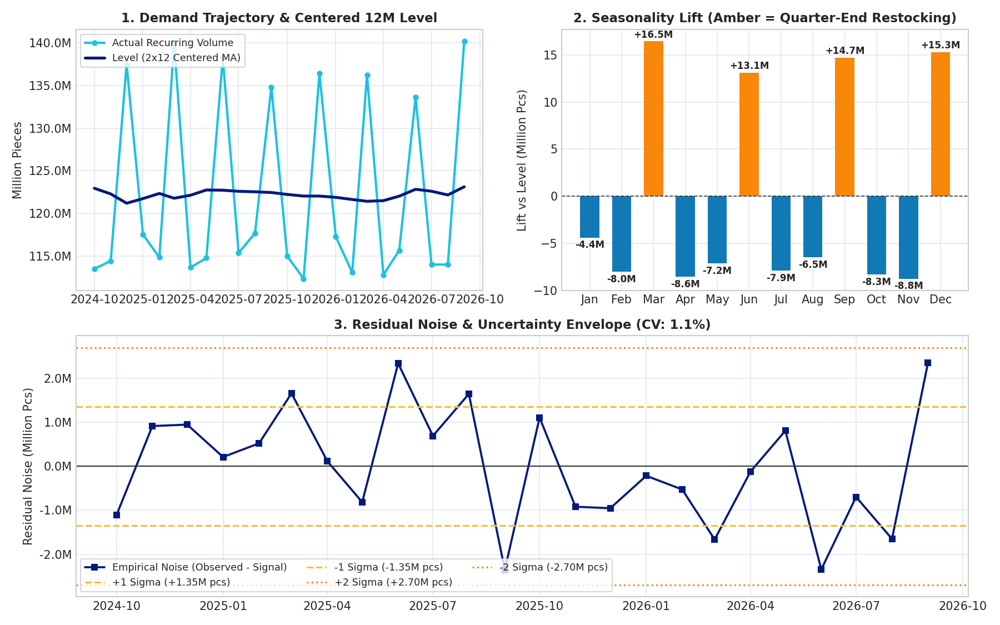
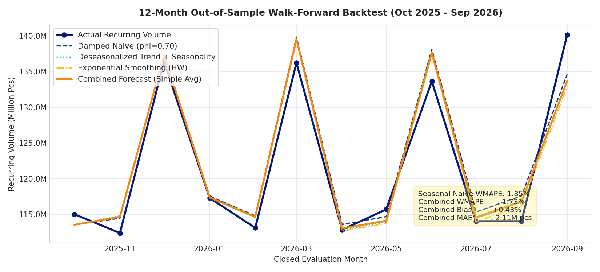
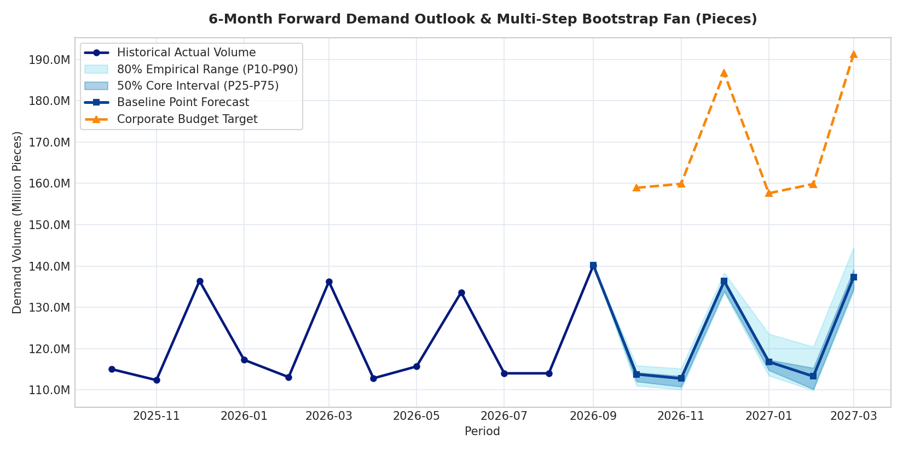
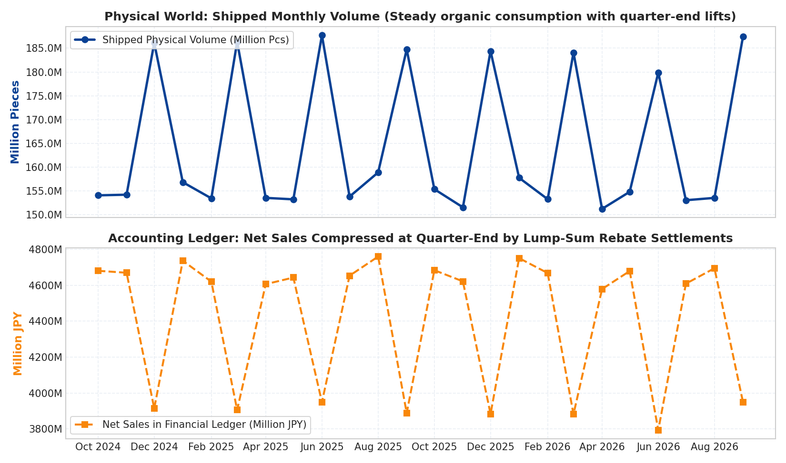
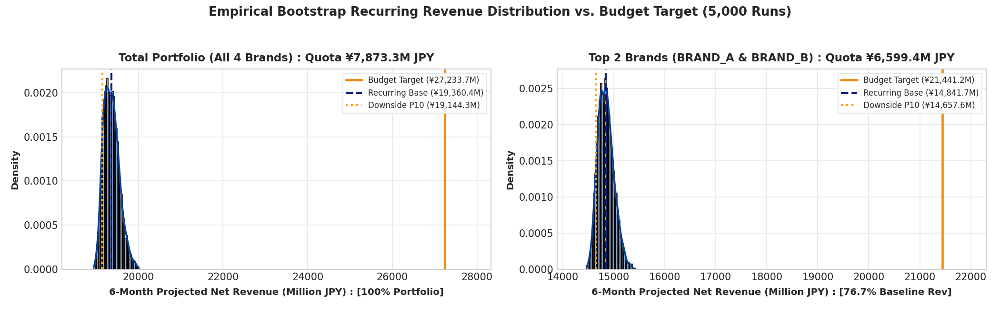
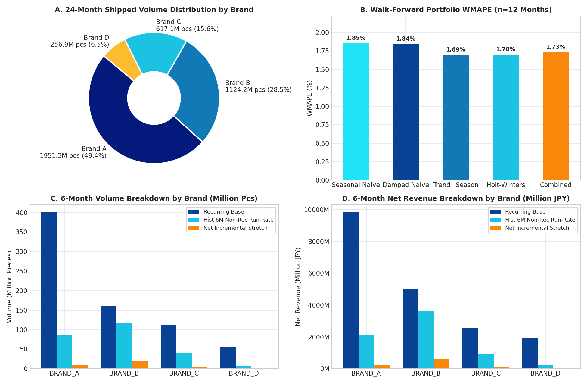

# Demand Forecasting & Commercial Gap Analysis
Japan Contact Lens Portfolio | Historical: Oct 2024 – Sep 2026 (24M) | Forecast: Oct 2026 – Mar 2027 (6M)

## Overview

In the contact lens business, monthly shipments come from two different sources:
- **Recurring demand**: regular patient and account refills for daily and bi-weekly lenses.
- **Non-recurring demand**: one-off volume from hospital tenders, new retail chain rollouts, and seasonal bulk deals.

Forecasting total shipments with a single time-series model treats one-off promotional spikes as permanent growth, and makes it hard to see how much of the sales budget will come in organically versus how much the sales team has to close.

This project separates those two streams across 4 brands and 4 channels in two steps:
1. **Volume forecast (pieces)**: isolate recurring volume, compare four time-series models (including a plain Seasonal Naive benchmark) over a 12-month walk-forward backtest, run a 5,000-path multi-step bootstrap simulation for the next 6 months, and compare the remaining non-recurring quota against the last 6 months' non-recurring run-rate to find the true net stretch.
2. **Gross-to-net revenue (JPY)**: convert volume into net revenue using channel contra rates (rebates and trade allowances), and estimate price elasticity (PED) from historical non-settlement months to test where list price hikes or rebate cuts make sense.

### Key Results (Oct 2026 – Mar 2027)
- **Recurring volume**: projected at 730.27M pcs against a 1,014.18M pcs budget (72.0% coverage), with a P10–P90 range of 721.56M to 739.87M pcs.
- **Sales quota vs. historical run-rate**: the remaining 283.91M pcs (28.0%) has to come from commercial activity. Because the portfolio already averaged 249.68M pcs of non-recurring orders over the last 6 months, the **net incremental stretch** required above recent run-rate is **+34.24M pcs (+13.7%)**.
- **Net revenue gap**: after channel rebates, recurring demand brings in ¥19,360.4M (P10 floor: ¥19,144.3M) against the ¥27,233.7M net sales target, leaving a ¥7,873.3M non-recurring quota (¥6,899.5M historical run-rate + **¥973.8M net stretch**). Brand B makes up 64.1% of that net incremental stretch (+¥624.5M).

---

## 1. Historical Demand Split & Decomposition

Over the 24-month historical period, recurring refills made up 74.3% (2,933.08M pcs) of shipments and non-recurring orders made up 25.7% (1,016.47M pcs). Brand B relies the most on non-recurring promo and tender volume (42.1% non-recurring), while Brand D (toric lenses) comes mostly from steady patient refills (87.7% recurring).

| Brand Code | Brand Name | Modality | 24M Recurring (M pcs) | 24M Non-Recurring (M pcs) | 24M Total (M pcs) | Recurring Share |
|:---|:---|:---|:---:|:---:|:---:|:---:|
| BRAND_A | Brand A | 1-Day Spherical | 1,601.20M | 350.13M | 1,951.33M | 82.1% |
| BRAND_B | Brand B | 1-Day Premium | 650.70M | 473.45M | 1,124.15M | 57.9% |
| BRAND_C | Brand C | 2-Week Mainstream | 455.77M | 161.38M | 617.15M | 73.9% |
| BRAND_D | Brand D | 1-Day Toric | 225.41M | 31.51M | 256.92M | 87.7% |
| **Total** | **Portfolio Total** | **All Modalities** | **2,933.08M** | **1,016.47M** | **3,949.55M** | **74.3%** |

Before fitting the models, the monthly recurring series is split into level, seasonality, and residual noise (`src/decomposition.py`):

```text
Actual Volume = Level (2x12 Moving Average) + Seasonality + Residual
```

The baseline level averages 122.22M pcs/month. Seasonality shows clear quarter-end restocking peaks of +13.1M to +16.4M pcs in March, June, September, and December. Monthly residual noise is small (1.35M pcs std dev, CV = 1.1%).



---

## 2. Walk-Forward Backtest (12 Months)

Four time-series models and an equal-weight ensemble are tested out-of-sample over the last 12 months (Oct 2025 – Sep 2026) in `src/models.py`:

- **Seasonal Naive (Benchmark)**: plain baseline that repeats the same month last year (`y_{t-12}`) with zero trend.
- **Damped Naive (`phi = 0.70`)**: uses the same month last year plus damped year-over-year drift so quarter-end spikes don't compound across a multi-month horizon.
- **Trend + Seasonality (OLS)**: removes the monthly seasonal factors first, fits a linear trend on the deseasonalized series, and adds the seasonal lift back.
- **Exponential Smoothing (Holt-Winters)**: additive level and 12-month seasonality with initial slope set to zero.
- **Combined Forecast**: equal average of Damped Naive, Trend + Seasonality, and Exponential Smoothing.

| Model | Portfolio WMAPE | Portfolio Bias | MAE (M pcs) | RMSE (M pcs) | 16-Series Mean WMAPE | Notes |
|:---|:---:|:---:|:---:|:---:|:---:|:---|
| Seasonal Naive (Benchmark) | 1.85% | +0.79% | 2.26M | 2.75M | 5.50% | Baseline reference |
| Damped Naive (`phi = 0.70`) | 1.84% | +0.73% | 2.24M | 2.75M | **5.49%** | Best average accuracy on the 16 granular Brand x Channel series (wins 12 of 16) |
| Trend + Seasonality (OLS) | **1.69%** | +0.35% | **2.06M** | **2.73M** | 5.77% | Best fit on total portfolio volume |
| Exponential Smoothing (HW) | 1.70% | **+0.20%** | 2.06M | 2.83M | 5.78% | Lowest portfolio bias |
| **Combined (Simple Avg)** | **1.73%** | **+0.43%** | **2.11M** | **2.75M** | **5.65%** | **Used for final forecast (balances portfolio and granular error)** |

Trend + Seasonality and Holt-Winters beat the Seasonal Naive benchmark on the aggregated total (1.69%–1.70% vs. 1.85% WMAPE), while Damped Naive is more stable on the noisier Brand x Channel series (5.49% mean WMAPE, winning 12 out of 16). Taking a simple average keeps both portfolio and granular errors low without overfitting cell-level weights on a 12-month window.



---

## 3. 6-Month Volume Forecast & Multi-Step Bootstrap Range

To get uncertainty bounds for Oct 2026 – Mar 2027 without assuming normal errors on 24 months of data, `src/models.py: collect_multistep_residuals` collects the actual out-of-sample forecast errors at each horizon `h = 1..6`, and `src/simulation.py` resamples those horizon-specific residuals across 5,000 bootstrap paths.

- **Base forecast (730.27M pcs)**: expected recurring volume.
- **P10 floor (721.56M pcs)**: downside case for revenue risk (-8.71M pcs below base).
- **P90 buffer (739.87M pcs)**: upper bound for recurring safety stock (+9.60M pcs above base). Including the 283.91M pcs commercial quota, total supply capacity needed for the 6-month plan + P90 recurring buffer is **1,023.78M pcs**.

| Period | P10 Floor (M pcs) | Recurring Base (M pcs) | P90 Buffer (M pcs) | Budget Target (M pcs) | Non-Recurring Gap (M pcs) |
|:---|:---:|:---:|:---:|:---:|:---:|
| 2026-10 | 111.02M | 113.81M | 115.91M | 158.92M | 45.11M |
| 2026-11 | 110.11M | 112.77M | 115.18M | 159.87M | 47.10M |
| 2026-12 | 133.58M | 136.31M | 138.34M | 186.71M | 50.40M |
| 2027-01 | 113.46M | 116.82M | 123.58M | 157.60M | 40.78M |
| 2027-02 | 109.89M | 113.29M | 120.44M | 159.84M | 46.55M |
| 2027-03 | 133.84M | 137.27M | 144.46M | 191.24M | 53.97M |
| **6M Total** | **721.56M** | **730.27M** | **739.87M** | **1,014.18M** | **283.91M (28.0%)** |



---

## 4. Non-Recurring Volume Gap vs. Historical Run-Rate

Subtracting the 730.27M pcs recurring baseline from the 1,014.18M pcs budget leaves a total non-recurring quota of 283.91M pcs. However, the commercial team does not start from zero: over the last 6 historical months (Apr – Sep 2026), non-recurring orders already averaged **249.68M pcs**. Comparing the total quota against that recent run-rate isolates the **net incremental stretch (+34.24M pcs)** that requires new commercial effort.

### By Channel
| Channel Code | Channel Name | Target Budget (M pcs) | Recurring Base (M pcs) | Total Quota (M pcs) | Last-6M Non-Rec Run-Rate | Net Stretch (M pcs) | Main Lever |
|:---|:---|:---:|:---:|:---:|:---:|:---:|:---|
| CH_RETAIL_CHAIN | Optical Retail Chains | 409.06M | 292.93M | 116.14M | 97.21M | **+18.93M** | Quarter-end volume tiers & new store rollouts |
| CH_ONLINE | E-Commerce / DTC | 349.32M | 253.79M | 95.53M | 88.93M | **+6.60M** | Multi-box subscription bundles |
| CH_CLINIC_INST | Clinics & Ophthalmologist | 154.60M | 110.58M | 44.02M | 38.22M | **+5.80M** | Hospital tenders & fitting kits |
| CH_DIRECT_ACC | Direct Independent Accounts | 101.20M | 72.98M | 28.22M | 25.31M | **+2.91M** | Q4/Q1 bulk deals & stretch rebates |
| **TOTAL** | **Portfolio Total** | **1,014.18M** | **730.27M** | **283.91M** | **249.68M** | **+34.24M** | |

### By Brand
| Brand Code | Brand Name | Modality | Target Budget (M pcs) | Recurring Base (M pcs) | Total Quota (M pcs) | Last-6M Non-Rec Run-Rate | Net Stretch (M pcs) |
|:---|:---|:---|:---:|:---:|:---:|:---:|:---:|
| BRAND_A | Brand A | 1-Day Spherical | 495.94M | 400.33M | 95.61M | 86.01M | **+9.60M** |
| BRAND_B | Brand B | 1-Day Premium | 297.61M | 161.22M | 136.39M | 116.30M | **+20.09M** |
| BRAND_C | Brand C | 2-Week Mainstream | 156.13M | 111.98M | 44.15M | 39.88M | **+4.27M** |
| BRAND_D | Brand D | 1-Day Toric | 64.50M | 56.74M | 7.76M | 7.49M | **+0.28M** |
| **TOTAL** | **Portfolio Total** | **All Modalities** | **1,014.18M** | **730.27M** | **283.91M** | **249.68M** | **+34.24M** |

---

## 5. Gross-to-Net Financials: Why Forecast Volume First

In the accounting ledger (`fact_sales_transaction.csv` and `fact_trade_contra.csv`), quarterly volume rebates are settled in lump sums at the end of March, June, September, and December. Because of that, contra deductions jump from ~7.6% in normal months to ~35.8% on quarter-end months, making booked Net Sales drop right when physical shipments peak.

Forecasting ledger Net Sales directly would bake those accounting dips into the demand forecast. Instead, we forecast physical pieces first across the 16 Brand x Channel series, simulate each series using its own historical forecast residuals, sum simulated paths across brands/channels before taking P10/P90 percentiles, and apply each channel's annual contra rate (`src/finance.py`):

```text
Net Revenue (JPY) = Volume (Pcs) * Base List Price (JPY) * (1 - Channel Contra Rate)
```



---

## 6. Net Revenue Gap & Stretch by Brand & Channel (Million JPY)

Converting the bottom-up volume forecast into JPY shows a ¥19,360.4M recurring baseline (portfolio P10 floor: ¥19,144.3M) against the ¥27,233.7M budget. Of the ¥7,873.3M total non-recurring quota, ¥6,899.5M is covered by repeating the last 6 months' non-recurring run-rate, leaving **¥973.8M in net incremental stretch**.

### By Brand
| Brand Code | Brand Name | Target Net Rev (M JPY) | Rec Base (M JPY) | Downside P10 (M JPY) | Total Quota (M JPY) | Last-6M Non-Rec (M JPY) | Net Stretch (M JPY) | Quota % |
|:---|:---|:---:|:---:|:---:|:---:|:---:|:---:|:---:|
| BRAND_A | Brand A | ¥12,184.1M | ¥9,827.0M | ¥9,623.2M | ¥2,357.1M | ¥2,112.0M | **+¥245.1M** | 19.3% |
| BRAND_B | Brand B | ¥9,257.1M | ¥5,014.8M | ¥4,896.9M | ¥4,242.4M | ¥3,617.8M | **+¥624.5M** | 45.8% |
| BRAND_C | Brand C | ¥3,576.9M | ¥2,567.7M | ¥2,497.1M | ¥1,009.2M | ¥912.5M | **+¥96.7M** | 28.3% |
| BRAND_D | Brand D | ¥2,215.6M | ¥1,950.9M | ¥1,911.8M | ¥264.7M | ¥257.2M | **+¥7.5M** | 12.0% |
| **TOTAL** | **Portfolio Total** | **¥27,233.7M** | **¥19,360.4M** | **¥19,144.3M** | **¥7,873.3M** | **¥6,899.5M** | **+¥973.8M** | **28.0%** |

### By Channel
| Channel Code | Channel Name | Contra Rate | Target Net Rev (M JPY) | Recurring Base (M JPY) | Downside P10 (M JPY) | Total Quota (M JPY) | Last-6M Non-Rec (M JPY) | Net Stretch (M JPY) |
|:---|:---|:---:|:---:|:---:|:---:|:---:|:---:|:---:|
| CH_RETAIL_CHAIN | Optical Retail Chains | 18.5% | ¥10,920.9M | ¥7,734.8M | ¥7,537.6M | ¥3,186.1M | ¥2,684.1M | **+¥502.0M** |
| CH_ONLINE | E-Commerce / DTC | 22.0% | ¥8,952.5M | ¥6,409.8M | ¥6,291.9M | ¥2,542.7M | ¥2,332.9M | **+¥209.8M** |
| CH_CLINIC_INST | Clinics & Ophthalmologist | 10.5% | ¥4,538.6M | ¥3,205.8M | ¥3,140.1M | ¥1,332.8M | ¥1,153.3M | **+¥179.5M** |
| CH_DIRECT_ACC | Direct Independent Accounts | 15.0% | ¥2,821.7M | ¥2,010.0M | ¥1,967.8M | ¥811.7M | ¥729.1M | **+¥82.6M** |
| **TOTAL** | **Portfolio Total** | **18.2%** | **¥27,233.7M** | **¥19,360.4M** | **¥19,144.3M** | **¥7,873.3M** | **¥6,899.5M** | **+¥973.8M** |

*(Note: P10 values are computed by summing the 5,000 simulated paths across each group before taking the 10th percentile, so individual brand or channel P10s do not add up linearly to the portfolio P10.)*





---

## 7. Price Elasticity (PED) & Pricing Scenarios

To estimate price sensitivity by channel (`src/finance.py: estimate_channel_ped`), we remove monthly seasonality from volume (`Q_adj`), drop the 8 quarter-end rebate settlement months (`dim_calendar.csv: is_quarter_end == 1`) so lump-sum accruals don't skew unit prices (`P_net = Net Sales / Q`), and fit a log-log OLS regression across the remaining 16 non-settlement months:

```text
ln(Q_adj) = alpha + PED * ln(P_net)
```

Using the exact constant-elasticity demand curve (`Q_new = Q_base * (P_net_new / P_net_base) ^ PED`), we test both a **+5% list price hike** and an **unconditional 2pp contra rebate cut** (which raises effective net unit price `P_net` by `0.02 / (1 - contra_rate)`, or `+2.2%` to `+2.6%`):

| Channel Code | Channel Name | OLS PED (± SE, R²) | Avg Monthly Net Rev | +5% List Price Hike | Unconditional -2pp Rebate Cut | Practical Takeaway |
|:---|:---|:---:|:---:|:---:|:---:|:---|
| CH_CLINIC_INST | Clinics & Ophthalmologist | 0.00 (±0.69, R²=0.00) | ¥719.9M | +¥36.0M (0.0% vol) | +¥16.1M (0.0% vol) | Inelastic (doctor-prescribed); safe to trim rebates by 2pp or raise list price. |
| CH_RETAIL_CHAIN | Optical Retail Chains | -1.11 (±0.18, R²=0.74) | ¥1,760.9M | -¥9.4M (-5.3% vol) | -¥4.7M (-2.7% vol) | Elastic (`PED < -1`); unconditional price hikes or rebate cuts lose net revenue. Use conditional growth tiers instead. |
| CH_DIRECT_ACC | Direct Independent Accounts | -1.43 (±0.26, R²=0.68) | ¥459.3M | -¥9.5M (-6.7% vol) | -¥4.6M (-3.3% vol) | Elastic; avoid unconditional price hikes or rebate cuts. Use back-end stretch rebates on incremental Q4/Q1 volume. |
| CH_ONLINE | E-Commerce / DTC | -4.51 (±0.56, R²=0.82) | ¥1,469.1M | -¥231.2M (-19.8% vol) | -¥124.9M (-10.8% vol) | Highly price-sensitive; keep unit prices and baseline trade terms steady and push multi-box bundles. |

*(Methodological caveat: each channel regression uses `n = 16` non-settlement months of observational price and volume data without competitor price controls, so these elasticities should be treated as directional guides rather than causal experiments.)*

---

## 8. Summary of Actions

- **FP&A & Supply Chain**: use 730.27M pcs (¥19,360.4M) as the 6-month recurring baseline, 721.56M pcs (¥19,144.3M) as the P10 downside floor, and 739.87M pcs (+9.60M pcs recurring buffer, or 1,023.78M pcs total supply capacity including commercial quota) for December and March inventory planning.
- **Retail Chains (+¥502.0M net stretch above run-rate)**: because demand is elastic (`PED = -1.11`), an unconditional 2pp rebate cut loses ¥4.7M/month. Instead, hold baseline rates and require accounts to exceed their recurring baseline before unlocking top-tier quarterly rebates.
- **Online (+¥209.8M net stretch)**: keep unit prices and contra rates steady (`PED = -4.51`) and drive the +6.60M pcs incremental stretch through 90-pack and multi-box subscription bundles.
- **Clinics & Brand B (+¥179.5M clinic stretch; +¥624.5M Brand B stretch)**: focus hospital tenders and fitting kits on Brand B (64.1% of total company net stretch), and trim unconditional clinic contra rates by 2pp (`+¥16.1M/month`) where doctor-prescribed demand is price-inelastic.
- **Direct Accounts (+¥82.6M net stretch)**: avoid off-invoice price hikes (`PED = -1.43`) and use year-end stretch rebates on incremental bulk orders.

---

## 9. Project Structure & Setup

```text
Forecast/
├── data/                                             # Historical actuals, budget targets, channel & product tables
├── notebooks/
│   └── recurring_demand_forecast_evaluation.ipynb    # Main analysis & forecasting notebook
├── src/
│   ├── decomposition.py                              # 2x12 moving average decomposition
│   ├── models.py                                     # Seasonal Naive, Damped Naive, OLS Trend+Seasonality, Holt-Winters
│   ├── simulation.py                                 # Multi-step empirical bootstrap simulation
│   ├── finance.py                                    # Bottom-up forecast grid, run-rate stretch, OLS PED & pricing scenarios
│   └── metrics.py                                    # WMAPE, Bias, MAE, RMSE
├── figures/                                          # Generated charts
└── requirements.txt
```

Run the notebook locally:
```bash
pip install -r requirements.txt
jupyter notebook notebooks/recurring_demand_forecast_evaluation.ipynb
```
